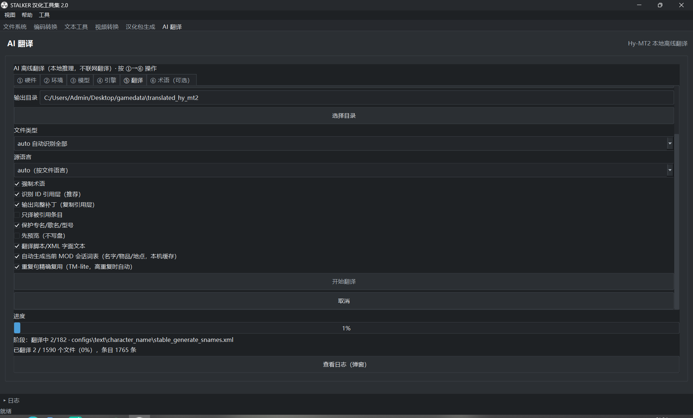

# ai_translate 2.0.8

面向 **STALKER Localization Toolkit 2.x**（C++/Qt）的本地离线 AI 翻译插件。
基于 Hy-MT2 / llama.cpp 在本机完成 X-Ray 文本 XML、cfgxml、ltx 与脚本的翻译，
不依赖在线翻译 API。

仓库：<https://github.com/qy0214/stalker-localization-toolkit-ai-translate-2x>

## 版本迭代

- **2.0.8** 上下文串入修复：场景上下文（`前一句/后一句`）被 1.8B 小模型当成正文翻出、写进相邻条目（实测 `bar_arena_man_job_172` 译文被上一条长译文覆盖，全表 305 条中招）。三层修复：①源头减险——极短条目（<12 字符）不注入上下文；②污染检测硬校验——译文出现上下文标签或极短源文吐出超长段落时，去掉上下文重译一次，仍异常则保留原文绝不落坏译文；③终检新增第五类扫描——输出残留上下文标签的条目点名。新增 test_2808_context_bleed 17 项回归 + 恶意注入 E2E。
- **2.0.7** 翻译完整性三修：①长度比闸门按语言对设阈值（俄→中下限 0.15，消除 bio 表 77 条正确译文被误判漏译、各白跑一次重试）；②西里尔全大写短名不再一律当专名跳过——整条命中随包术语库时直接取既有译名（БАРМЕН→酒保、ПРИЗРАК→幽灵等），用户词库优先，未收词条送模型；③终检新增条目级漏译扫描，输出仍等于俄文源文的条目点名（已登记专名除外），并提示清空输出目录重跑补译。新增 test_2707_fixes 34 项回归。
- **2.0.6** 跟随宿主 B250：中小产物（运行库 zip，≤256MB）优先走平台 `api.host.http_download`（失败不留半文件、受联网开关管）；GB 级模型因宿主门面无进度/断点/长时窗仍走自建流式。另修：宿主门面失败回退时留痕（60s 限频）；`ui_call` 线程探测异常默认投递而非直接执行。
- **2.0.5** 跟随宿主、去除二次实现：小文本请求改用平台 `api.host.http_*`（B249+），UI 线程调度改用宿主 `api.ui.post`；老宿主保留兼容回退，流式下载仍用自建管道。文档同步联网能力已内置、不再有独立"联网插件"。
- **2.0.4** 兼容性修复：修复平台 BETA.249 等正式版上六个步骤页内容显示不全（只露一行 / 控件间巨大空白）——改为与平台内置页同构的「直接 pack + 弹性占位」布局，不依赖各版本宿主 viewport 行为差异，全版本内容完整显示。
- **2.0.3** 提示词与规则约束强化：规则违规遥测（任务收尾输出「提示词体检」，按触发次数点名最薄弱规则）；长度比闸门（补上“翻了一半/过度扩写”的静默漏洞，带要求重试一次）；高频专名定译（全文扫描高频专名，复用会话词表定译管线收敛译名漂移）；俄/英提示词分区化重构；官方模板措辞 A/B 开关（默认关）。
- **2.0.2** 动态多路翻译 + 整 MOD 终检：多路翻译不再只有 1/2/4 固定三档，按显卡显存（GPU）或物理内存（CPU）自动生成 1..16 路选项，每档带显存估算、预算内最高档标「推荐」，信息不足回落固定档；翻译收尾全量终检（账本在盘、文本表可解析且不缺 ID、掩码残留扫描，只报告不删改）。
- **2.0.1** 首个平台发布版：内置双档 Hy-MT2 模型、四后端自动检测、注册表接入（检查更新/一键安装）、会话词表、TM-lite、原子写盘与完成账本。

## 功能

- 内置两档本地模型：Hy-MT2-7B Q4_K_M、Hy-MT2-1.8B Q8_0；也支持自选任意 GGUF 模型。
- 四种运行后端：CPU / CUDA 12.4 / CUDA 13.4 / Vulkan，自动检测硬件并给出推荐档位。
- 多路翻译按硬件动态生成路数选项（GPU 按显存、CPU 按内存，封顶 16 路，信息不足回落 1/2/4）。
- 八道译后闸门（占位符/换行/粗口/完整性/残留源文/长度比/回显等），任务收尾输出「提示词体检」遥测报告。
- 模型与 llama.cpp 运行库不随包分发；插件自动测速选源、按官方 SHA-256 校验，支持断点续传、取消与失败换源。
- 随包术语库 9059 条，分内置只读层与用户覆盖层；支持会话词表、技术精确表与参考软提示层。
- 场景批处理：连续短对话按上下文批量翻译，失败回退逐条；中文去翻译腔后处理。
- 完成账本 + 原子写盘：输入变化或输出未覆盖全部条目时自动重译，中断不留半截成品。
- 网络层跟随宿主：小文本请求（翻译/健康检查）优先用平台 `api.host.http_*` 门面（B249+）；中小产物（≤256MB，运行库 zip）优先用 B250 新增的 `api.host.http_download`（失败不留半文件、受联网开关管）；GB 级模型走自建流式管道（断点续传/进度/长时窗，宿主门面无此能力）；老宿主自动回退标准库 urllib 或 ctypes WinHTTP，不引入任何第三方 Python 依赖。
- 线程调度跟随宿主：B249+ 用原生 `api.ui.post` 投递 UI 回调（宿主管线程与异常），老宿主回退自建队列 + 定时器泵（纯兼容层）。
- 界面完全走宿主 `api.ui` 门面；工作线程只操作数据，控件操作统一投递回 UI 线程。

## 界面说明

插件只在**工具集的一个工具页内**再分页：`① 硬件 / ② 环境 / ③ 模型 / ④ 引擎 / ⑤ 翻译 / ⑥ 术语（可选）`，
不额外注册宿主工具页。



- 顶部页签：插件页内切换六个步骤；⑥ 只放附加提示词与强制术语，不影响前五步。
- `输出目录` / `文件类型` / `源语言`：翻译参数；`文件类型` 默认「auto 自动识别全部」。
- 勾选项：强制术语、识别 ID 引用层、输出流补丁、只译引用项、保护专名/型号、先预览、
  翻译脚本/XML 字面文本、自动生成当前 MOD 会话词表、重复时精确复用（TM-lite）。
- 底部**进度条**：百分比语义不变 —— 下载按字节推进，翻译按本轮处理的文件数推进。
- `阶段：翻译中 2/182 · configs\text\character_name\stable_generate_names.xml`：
  当前处理到第几个文件、正在处理哪个。
- `已翻译 2 / 1590 个文件（0%），条目 1765 条`：分母是**自动识别**出来的整个 MOD
  待翻译文件总数（选目录或启动工具时后台勘察，只算确实含可译文本的文件），
  分子是已翻译的文件数，括号后是累计翻译条目数。
- `查看日志（弹窗）`：日志不占页面高度，点击在独立窗口看最近 300 行；
  完整日志见 `%LOCALAPPDATA%\STALKER Localization Toolkit\ai_translate\logs\translate_run.log`。

## 接入平台插件管理（注册表 / 检查更新 / 一键安装）

平台的插件管理器只认一份硬编码的线上注册表
（`ALittleHuman/STALKER-Localization-Toolkit-2.x-Network-Plugin/main/plugins.json`）。
**联网能力已内置于平台**（BETA.249 起随包保留 Python SSL/libssl，并提供
`plugins/_sdk/http_winhttp.py`；插件可直接用 urllib），**不再需要单独安装
"联网插件"**——旧 Network-Plugin 插件是过时产物、其仓库已删，此处只保留
注册表数据地址的含义，不代表还要装那个插件。
**我们的条目还没写进去，所以客户只有平台时在插件管理里搜不到、也装不了。**
要打通需要三步：

```powershell
# 1) 改版本号 + 重建 zip/清单 + 打印可直接粘贴的注册表条目
python tools/release_plugin.py 2.0.8

# 2) 把安装包传成 GitHub Release 资产（tag = v<版本号>）
gh release create v2.0.8 dist/ai_translate_plugin_v2.0.8_install.zip --title "ai_translate 2.0.8"

# 3) 把第 1 步打印的条目追加进注册表的 plugins 数组（需要该仓库写权限）
```

之后客户流程：平台 → 插件管理 → 检查插件更新 → 选中 ai_translate →
「现在下载并安装」→ 重启工具集即可用（模型与运行库由插件按显卡档位自动下载）。

字段含义、版本号规则与已知限制见 [`docs/PLUGIN_REGISTRY.md`](docs/PLUGIN_REGISTRY.md)。

## 安装

把 `dist/ai_translate_plugin_v2.0.8.zip` 解压到工具集的 `plugins/` 目录，形成：

```text
<工具集目录>\
    plugins\
        ai_translate\
            plugin.py
            assets\
                xray_pkg.zip
                stalker_termbase.json
                glossary_builtin.json
                THIRD_PARTY_NOTICES.txt
```

重启工具集后，在工具页中打开「AI 翻译」。页面内部恢复为 6 个页签：
① 硬件 / ② 环境 / ③ 模型 / ④ 引擎 / ⑤ 翻译 / ⑥ 术语（可选）。
每个页签内嵌独立 viewport 并压低最小高度，不再出现等分高度的大片空白。
④ 页多路翻译按显卡显存/内存动态生成 1..N 路选项（每档带显存估算），并按模型
结构实时估算显存。进度条常驻页签之外、
固定在页面底部，日志不占页面高度，点「查看日志（弹窗）」在独立窗口看
最近 300 行。本插件是**目录插件**，入口文件名固定为 `plugin.py`，
目录名 `ai_translate` 即插件 id。

插件包**不包含**模型、运行库、配置与日志。首次运行按硬件选择档位并下载；下载后
按官方 SHA-256 校验，文件不一致就删除并自动换下一个源。

运行数据默认落在：

```text
%LOCALAPPDATA%\STALKER Localization Toolkit\ai_translate
    bin\        llama.cpp 运行库
    models\     模型
    downloads\  下载缓存
    logs\       运行日志
```

绿色版：在 `plugin.py` 同目录放一个空的 `portable.txt`，数据改为写插件目录；
只读安装位置会自动回落到 `%LOCALAPPDATA%`。

## 仓库结构

| 路径 | 说明 |
|---|---|
| `plugins/ai_translate/plugin.py` | 插件入口，单文件实现 |
| `plugins/ai_translate/assets/` | X-Ray 解析器 + 术语数据（随包只读） |
| `dist/ai_translate_plugin_v2.0.8.zip` | 可直接分发的插件包 |
| `dist/ai_translate_plugin_v2.0.8_install.zip` | 平台安装包（顶层 `ai_translate/`） |
| `RELEASE_MANIFEST.md` / `release_manifest.json` | 发布清单（版本、哈希、一致性核对） |
| `tests/test_2x_contract.py` | 严格宿主契约测试 |
| `tests/fake_host.py` | 严格宿主假件 |
| `tests/test_ai_translate_fixes.py` | 功能回归测试 |
| `tests/test_dynamic_parallel.py` | 动态多路翻译回归测试（2.0.2） |
| `tests/test_prompt_rules.py` | 提示词与规则约束回归测试（2.0.3） |
| `tests/test_ui_fallback.py` | 页签布局 + 宿主门面跟随回归测试（2.0.4/2.0.8） |
| `tests/test_share_package.py` | 分享包卫生与发布包一致性测试 |
| `tools/gen_release_manifest.py` | 重建 zip 与清单，可做漂移门禁 |
| `tools/release_plugin.py` | 发版助手：改版本号 → 重建包 → 打印注册表条目 |
| `docs/PLUGIN_REGISTRY.md` | 接入平台插件管理（注册表/检查更新/一键安装）说明 |
| `docs/plugins_entry.ai_translate.json` | 现成的注册表条目（追加进 plugins.json 即可） |
| `docs/images/` | README 引用的界面截图 |
| `THIRD_PARTY_NOTICES.md` | 第三方来源、许可状态与致谢 |
| `.github/workflows/ci.yml` | CI：跑全量测试 + 发布清单门禁 |

## 版本与校验

- 插件版本：`ai_translate 2.0.8`
- 宿主插件 API：`1`
- 插件入口 SHA-256：
  `977a18b9f11c8c47555ce814e75f5afbbbc03b7e4ba085b6780f8965685387dd`
- 当前 zip SHA-256：
  `55a8feb85d9729219e52e0ea4158d160f21f2927d520388ec570ba6d76c23fe0`
- 平台安装包 SHA-256（顶层 `ai_translate/`）：
  `700561ca8fe7161469a1d18be018e9d55fabbdc0fe8fca38e243d6f9e68915b5`
- 术语规模：`glossary_builtin.json` 9059 条 / `stalker_termbase.json` 9059 条；
  11 个分类，两个文件条目数一致。
- 下载链路官方哈希：llama.cpp `b11612` 的 6 个 Windows 包 + 2 个 HuggingFace 模型。

```powershell
Get-FileHash 'dist\ai_translate_plugin_v2.0.8.zip' -Algorithm SHA256
```

完整核对结果见 [`RELEASE_MANIFEST.md`](RELEASE_MANIFEST.md)。

## 开发与测试

```powershell
# 宿主契约测试
python tests/test_2x_contract.py

# 功能回归测试
python tests/test_ai_translate_fixes.py

# 分享包 / 发布包一致性
python tests/test_share_package.py

# 重建 zip 与清单（--check 只校验不写盘）
python tools/gen_release_manifest.py --build
python tools/gen_release_manifest.py --check
```

当前全量测试：契约 67 项、功能回归 356 项、动态多路 42 项、提示词规则 46 项、
页签与宿主门面 21 项、分享包 30 项，全部通过。

进度显示：底部进度条保持百分比语义（下载按字节、翻译按本轮处理文件数）；
旁边两行文字给出直观计数——`阶段：翻译中 12/87 · configs\items\x.ltx` 和
`已翻译 12 / 87 个文件（14%），条目 345 条`。分母是**自动识别**出来的整个
MOD 待翻译文件数（选目录或启动工具时后台勘察，含可译文本的文件）。

## 许可

本仓库自身代码按 **GPL-3.0** 分发，见 [`LICENSE`](LICENSE)。

第三方来源与许可见 [`THIRD_PARTY_NOTICES.md`](THIRD_PARTY_NOTICES.md)：

- X-Ray 解析器与翻译流程参考
  [wzyddg/stalker_auto-trans-tool_remake](https://github.com/wzyddg/stalker_auto-trans-tool_remake)
  （上游未声明许可证，版权归原作者；本仓库保留来源说明，不主张额外授权）；
- llama.cpp：MIT；Hy-MT 模型：Apache-2.0；二者均不随仓库分发。

该 GPL-3.0 许可不改变上述第三方组件的版权与授权状态。
